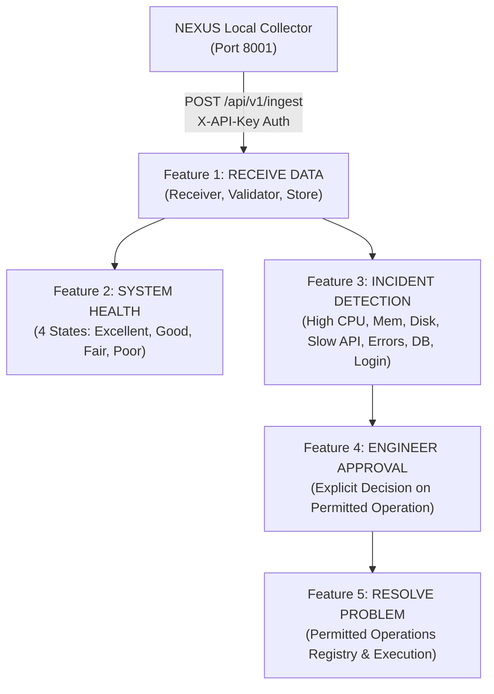

# NEXUS Central SaaS Architecture Specification
**CICADA 2026 — NEXUS OBSERVE**  
**Component**: NEXUS Central SaaS  
**Version**: 1.0.0  
**Port**: Backend 8002, Frontend 3001

---

## 1. System Overview

NEXUS Central SaaS provides centralized visibility, incident detection, and human-in-the-loop problem resolution across all monitored infrastructure.

## 2. Locked Core Features

1. **Receive Data**: Authenticated ingest from Local Collector with validation of required fields, timestamps, categories, and sanitization flags.
2. **System Health Monitoring**: Continuous calculation of overall and per-service health across 4 states (Excellent, Good, Fair, Poor) and detection of stale telemetry.
3. **Incident Detection**: Anomaly identification for all 6 failure modes and system resource saturation.
4. **Engineer Approval**: Explicit engineer authorization before problem resolution.
5. **Resolve Problem**: Execution of approved, permitted remediation actions with truthful execution results.

## 3. Excluded Modules (Strictly Adhered)
No Incident Correlation, AI Root Cause, Solution Recommendation, Automated Remediation, Verification & Recovery, Incident Records, Alerts/Notifications, Dependency Maps, Analytics/Reports, or Multi-tenancy.
