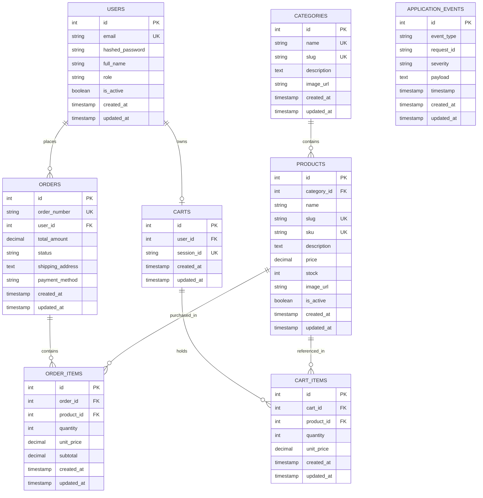

# NEXUS Demo Portal — Database Schema Specification

## 1. Overview
The database layer is built on PostgreSQL with SQLAlchemy 2.0 ORM and managed through Alembic migrations.

## 2. Entity Relationship Diagram

## 3. Data Integrity & Safety Constraints
- **SKU & Slug Uniqueness**: Products and categories enforce unique slugs and SKUs for SEO-friendly routing and catalog integrity.
- **Cascading Deletes**: User removal cascades to their cart, while orders and order items remain historical records with `RESTRICT` on product deletion.
- **Non-destructive Failure Testing**: Controlled database fault injection scenarios test connectivity refusal without dropping or altering production tables.
